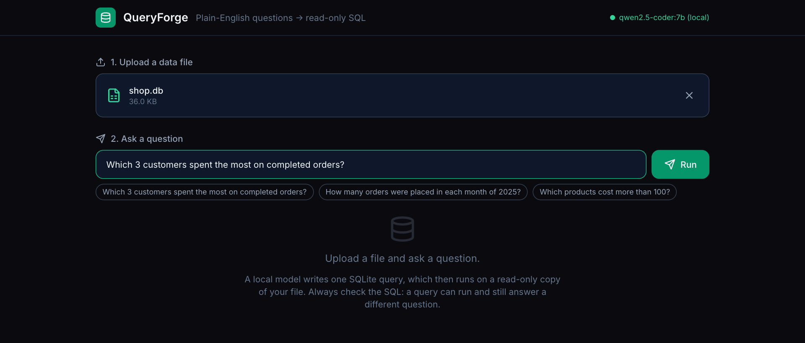
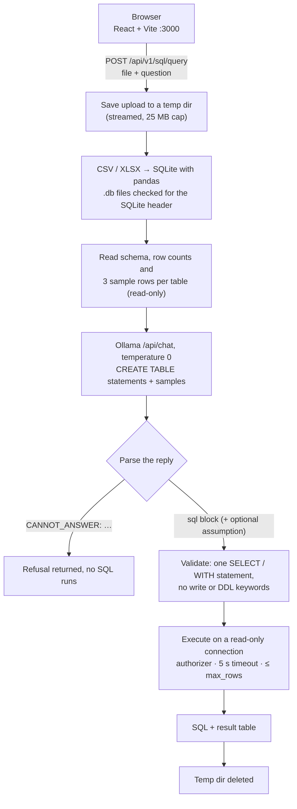

<div align="center">

# QueryForge

**Ask a CSV, Excel or SQLite file a question in plain English, and see the SQL that answers it.**

A local model (via [Ollama](https://ollama.com)) writes one SQLite query, which runs on a read-only copy of your
file. You get the SQL and the result table. Your file and your question stay on your machine: no API key, no paid
service.
The read-only guarantee comes from the database connection itself, not from checking the model's text.



<sub>The real app running locally, with the sample database loaded and a question ready to run.</sub>

**[Quick start](#quick-start)** ·
**[Try the demo](#try-the-demo)** ·
**[Evaluation](#evaluation)** ·
**[Guardrails](#guardrails)**

[](https://github.com/abhiishek-sharma/QueryForge/actions/workflows/ci.yml)


[](LICENSE)

</div>

---

<details>
<summary><b>Contents</b></summary>

- [Quick start](#quick-start)
- [Try the demo](#try-the-demo)
- [What you get](#what-you-get)
- [How it works](#how-it-works)
- [Evaluation](#evaluation)
- [Guardrails](#guardrails)
- [Limitations](#limitations)
- [Tests](#tests)
- [Configuration](#configuration)
- [License](#license)

</details>

## Quick start

Tested on an Apple M1 with 16 GB RAM and macOS, using Python 3.12, Node 22+ and Ollama 0.40.

**1. Install Ollama and pull the model** (one-time; about a 4.7 GB download, and the model uses about 5 GB of RAM
while loaded):

```bash
brew install ollama          # or download from https://ollama.com/download
ollama serve                 # leave running (or: brew services start ollama)
ollama pull qwen2.5-coder:7b
```

**2. Backend** (a new terminal, from the repo root):

```bash
cd backend
uv venv --python 3.12 && uv pip install -r requirements.txt   # or: python3.12 -m venv .venv && .venv/bin/pip install -r requirements.txt
.venv/bin/uvicorn main:app --port 8000
```

**3. Frontend** (another terminal, from the repo root):

```bash
cd frontend
npm ci && npm run dev
```

Open <http://localhost:3000>. The header should show `qwen2.5-coder:7b (local)` with a green dot.

## Try the demo

1. Upload `samples/shop.db`: a synthetic shop with 4 tables (`customers`, `products`, `orders`, `order_items`) and
   made-up names.
2. Ask **Which 3 customers spent the most on completed orders?**
3. You should see a 3-table `JOIN … WHERE o.status = 'completed' … ORDER BY … LIMIT 3` and three rows, with
   **Maya Tanaka** on top.
4. Ask something the data can't answer, such as **What is the email address of each customer?** The model replies
   that it can't answer, and no SQL runs.
5. For a single-table CSV, upload `samples/sales.csv` and ask **Total revenue by category for completed orders**.

This is the query `qwen2.5-coder:7b` wrote for step 2 in the committed evaluation run, and what it returns on
`samples/shop.db`:

```sql
SELECT c.name, SUM(oi.quantity * oi.unit_price) AS total_spent
FROM customers c
JOIN orders o ON c.id = o.customer_id
JOIN order_items oi ON o.id = oi.order_id
WHERE o.status = 'completed'
GROUP BY c.id
ORDER BY total_spent DESC
LIMIT 3
```

| name | total_spent |
|---|---|
| Maya Tanaka | 3579.0 |
| Ravi Moreau | 3338.0 |
| Lena Moreau | 3244.0 |

<details>
<summary><b>The same flow without the UI</b></summary>

```bash
curl -s -F file=@samples/shop.db \
     -F "question=Which 3 customers spent the most on completed orders?" \
     http://localhost:8000/api/v1/sql/query | python3 -m json.tool
```

The response contains `generation.sql`, `generation.assumption` (when the model chose one reading of an ambiguous
question), `generation.cannot_answer`, `result.columns`, `result.rows`, `result.truncated` and `execution_error`.
There is no confidence score: the model doesn't produce one, and SQL that passes validation and runs can still be the
wrong answer.

</details>

## What you get

- **The SQL, always.** Every answer shows the query that produced it, with a copy button, so you can check it.
- **Your own files:** SQLite (`.db`, `.sqlite`, `.sqlite3`), CSV and Excel (`.xlsx`), up to 25 MB.
- **A model that can say no.** Questions the schema can't answer get `CANNOT_ANSWER` and a reason, and no SQL runs.
  When a question is ambiguous, the model may state the reading it chose.
- **Read-only by construction.** The query runs on a read-only, query-only SQLite connection with an authorizer,
  a timeout and a row cap (see [Guardrails](#guardrails)).
- **Local.** The model runs in Ollama on your machine and the backend listens on `127.0.0.1` only; the page's web
  fonts are the only thing loaded from the internet.
- **Evaluation results.** A script that scores the model's *results* against hand-written reference queries,
  with the per-question output committed.

## How it works



| Path | What it does |
|---|---|
| `backend/app/api/sql_endpoints.py` | `/api/v1/sql/query` and `/api/v1/sql/health` |
| `backend/app/services/sql_agent_service.py` | Prompt, Ollama call, and parsing the model's reply |
| `backend/app/utils/sql_safety.py` | Text-level validator (first filter only) |
| `backend/app/db/readonly.py` | Read-only executor, which enforces the guarantees below |
| `backend/app/utils/schema_extractor.py` | Upload conversion and schema extraction |
| `samples/make_samples.py` | Regenerates `shop.db` and `sales.csv` (deterministic) |
| `eval/` | Questions, the scorer and the committed results |

## Evaluation

`eval/run_eval.py` sends 16 fixed questions to the real local model and compares each query's **result rows** with
the result of a hand-written reference query. Passing validation or running without errors doesn't count as
correct. The question types are simple filter, aggregation, join, ambiguous and unanswerable.

On `samples/shop.db` (synthetic data, `qwen2.5-coder:7b`, 2026-11-17):

| Category | Correct |
|---|---|
| filter | 4/4 |
| aggregation | 4/4 |
| join | 4/4 |
| ambiguous | 2/2 (the model stated its assumption in 1 of the 2) |
| unanswerable | 2/2 |
| **total** | **16/16** |

**Latency.** In the committed run the generation latency with the model already loaded was a median of **48.5 s**
(p95 90.9 s) on an M1 with 16 GB. An earlier run the same day, on the same machine, measured a median of 4.7 s (p95 15.0 s;
commit `1b26da1`). Latency clearly depends on the machine and what else it is running, so expect anything from a
few seconds to over a minute per question on a 16 GB laptop. The first question after the model loads is slower.

Full per-question output, including each generated query and the scoring rules, is in
[eval/results.md](eval/results.md) (raw data: [eval/results.json](eval/results.json)). To reproduce, with Ollama
running:

```bash
cd backend && .venv/bin/python ../eval/run_eval.py
```

This is a small set on one synthetic schema, and the person who wrote it also wrote the prompt. It shows how the
demo behaves. It is not a benchmark, and it says nothing about accuracy on other databases.

## Guardrails

**What the database connection enforces.** Each item has a test in `backend/tests/test_readonly.py`, and the tests run
the SQL directly so it never passes through the validator:

- The file opens with `mode=ro&immutable=1`, and `PRAGMA query_only = ON` is set.
- An SQLite authorizer allows only reads, `SELECT`, recursive CTEs and function calls. `INSERT`, `UPDATE`, `DELETE`,
  DDL, `ATTACH`, `PRAGMA`, `VACUUM INTO`, transactions and `load_extension()` are all refused.
- Only one statement runs per request.
- Queries time out after **5 s** (`QUERY_TIMEOUT_SECONDS`), enforced with an SQLite progress handler. A runaway
  recursive CTE is stopped this way.
- A single string or blob value can be at most **1 MB**.
- At most **100 rows** are returned by default, and the `max_rows` request field is capped at **1000**. The cap comes
  from `fetchmany`; the SQL is not rewritten. The response says when a result was truncated.

<details>
<summary><b>The upload path and the validator</b></summary>

**What the upload path enforces** (tests in `backend/tests/test_endpoints.py`):

- Uploads are capped at **25 MB** (`MAX_UPLOAD_MB`), and anything larger returns HTTP 413.
- Accepted file types are `.db`, `.sqlite`, `.sqlite3`, `.csv` and `.xlsx`. `.db` files must start with the SQLite
  header.
- Questions can be at most 1000 characters.
- Uploads go to a temporary directory that is deleted after each request.

**The validator** (`sql_safety.py`) only gives clearer error messages before execution. It strips comments and checks
sqlparse tokens, so `'a--b'` or a column named `exec` is fine. It is **not** the security boundary: if it misses
something, the connection still refuses the write, and a test covers exactly that case.

</details>

## Limitations

- **The SQL can be wrong.** A query that runs can still answer a different question. Always read the SQL. The eval
  above measures how often this happens on the sample data, and only on that data.
- With ambiguous questions, the model picks one reading. It doesn't always say which one (see `eval/results.md`).
- Everything happens within one request: there is no conversation history, and each question re-uploads the file.
- Large files are slow. CSV and Excel files are fully loaded into memory by pandas, and the 25 MB cap is the only
  limit on that. Very wide schemas may not fit in the model's context window (4096 tokens by default in Ollama).
- `.xls` (old Excel), JSON and SQL dumps are not supported.
- This is a local, single-user demo. There is no authentication or rate limiting, and the backend listens on
  `127.0.0.1` only. Don't expose it to a network.
- Only tested with `qwen2.5-coder:7b`. Other models can be set with `OLLAMA_MODEL`, but the reply parsing is untested
  with them.

## Tests

```bash
cd backend && .venv/bin/python -m pytest -q     # 81 tests; no Ollama needed: the LLM is mocked
cd frontend && npm run build
```

CI (`.github/workflows/ci.yml`) runs both on every push.

## Configuration

All settings are optional. Copy `backend/.env.example` to `backend/.env` to change them.

| Variable | Default |
|---|---|
| `OLLAMA_URL` | `http://localhost:11434` |
| `OLLAMA_MODEL` | `qwen2.5-coder:7b` |
| `OLLAMA_TIMEOUT_SECONDS` | `180` |
| `QUERY_TIMEOUT_SECONDS` | `5` |
| `MAX_UPLOAD_MB` | `25` |
| `CORS_ORIGINS` | `http://localhost:3000,http://127.0.0.1:3000` |

## License

MIT. See [LICENSE](LICENSE).
